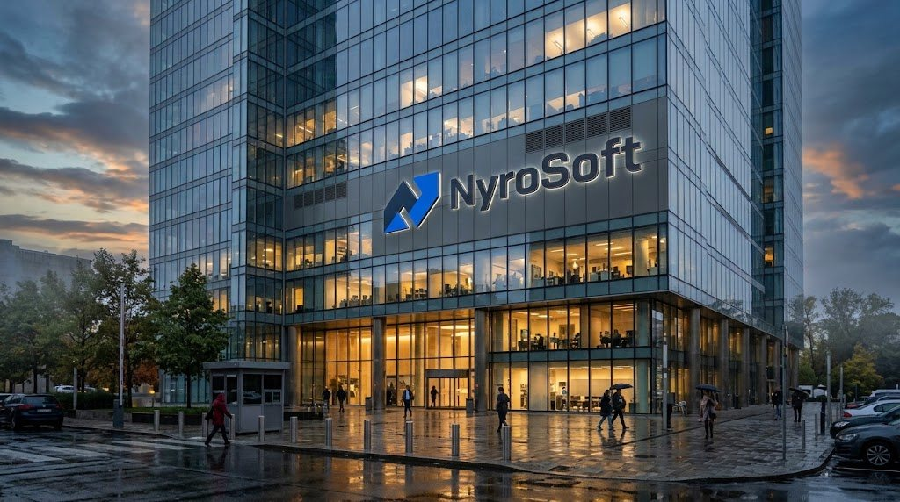
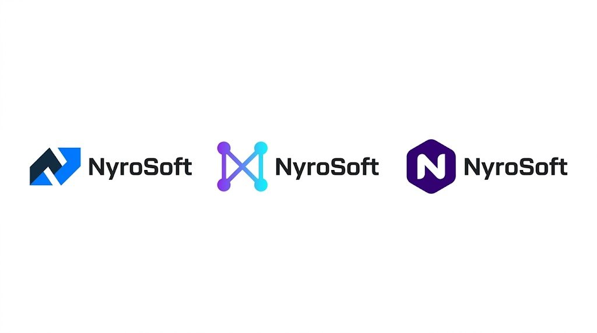
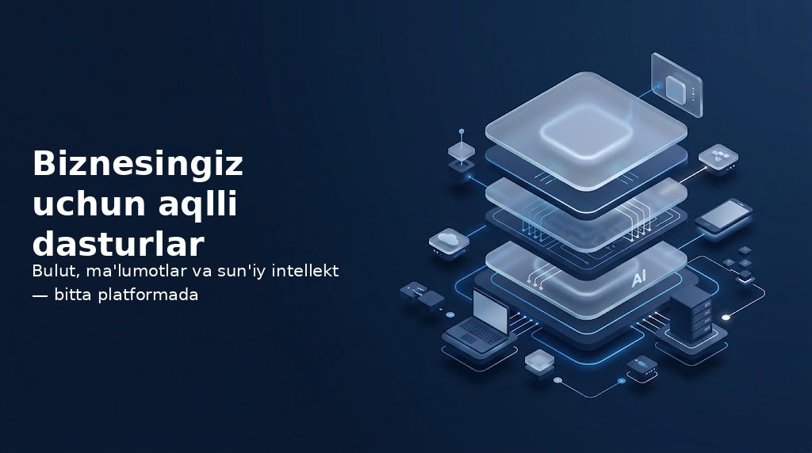
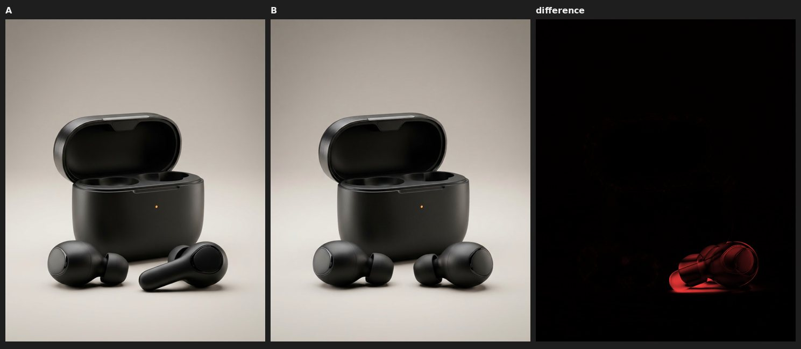
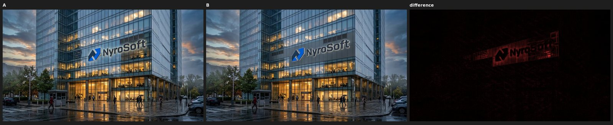
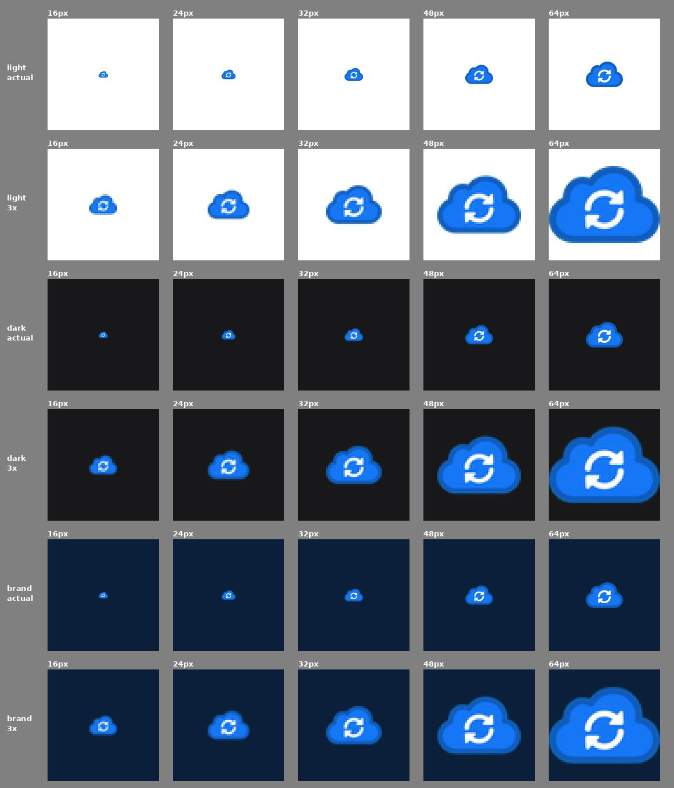
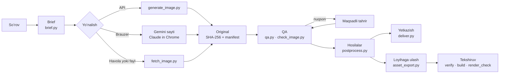

# 🎨 gemini-image — Claude uchun Gemini rasm skilli

**Claude'ga Google Gemini orqali rasm yaratish, tahrirlash va mavjud rasmni olishni oʻrgatadigan skill. Natija tekshiriladi, asl fayl oʻzgartirilmasdan topshiriladi va kerak boʻlsa loyihaga ulanadi**

Claude Code · claude.ai · Claude Desktop · Gemini API · Gemini sayti · Original + SHA-256 · QA · Loyiha integratsiyasi · Oʻzbekcha matn


📦 Repozitoriy: **https://github.com/ismoillooff/gemini-image**

---

## 📖 Loyiha haqida

**gemini-image** — Claude uchun yozilgan skill. Claude oʻzi raster rasm (foto, illustratsiya, banner) chiza olmaydi. Bu skill unga quyidagi ish tartibini oʻrgatadi:

1. **Brief.** Soʻrovdan maqsad, obyekt, kompozitsiya, materiallar, yorugʻlik, uslub va cheklovlar ajratib olinadi.
2. **Yaratish.** Rasm Gemini API, Gemini sayti (Claude in Chrome orqali, oʻz Google akkauntingiz bilan), Gemini havolasi yoki siz bergan fayl orqali olinadi.
3. **Original.** Fayl baytma-bayt saqlanadi, SHA-256 bilan tekshiriladi va `manifest.json` ga yoziladi.
4. **QA.** Rasm umumiy koʻrinishda va 100% kesimlarda koʻzdan kechiriladi. Nuqson topilsa, faqat oʻsha joy maqsadli tahrir bilan tuzatiladi.
5. **Hosilalar.** Oʻlcham, oʻzbekcha matn, logo, shaffof fon va format bilan ishlanadi. Hosilalar originaldan **alohida** fayl boʻladi.
6. **Yetkazish.** Rasm chatda koʻrsatiladi va original yuklab olish uchun beriladi. Loyiha rejimida asset kodga ulanadi, build va brauzerda tekshiriladi.

> Hujjat holati: README 2026-10-28 dagi kodga (v3.2.0) mos keladi.

---

## 🧭 Mundarija

- [✨ Imkoniyatlar](#-imkoniyatlar)
- [🖼️ Namunalar](#️-namunalar)
- [🏗️ Arxitektura](#️-arxitektura)
- [🔄 Rasm qanday tayyorlanadi](#-rasm-qanday-tayyorlanadi)
- [🧰 Texnologiyalar va talablar](#-texnologiyalar-va-talablar)
- [🗂️ Loyiha tuzilmasi](#️-loyiha-tuzilmasi)
- [🚀 Oʻrnatish](#-oʻrnatish)
- [💬 Foydalanish misollari](#-foydalanish-misollari)
- [🌍 Muhitlar: nima qayerda ishlaydi](#-muhitlar-nima-qayerda-ishlaydi)
- [🛠️ Skriptlar va buyruqlar](#️-skriptlar-va-buyruqlar)
- [🎚️ Sifat rejimlari](#️-sifat-rejimlari)
- [🧱 Loyiha rejimi](#-loyiha-rejimi)
- [⚙️ Muhit oʻzgaruvchilari (.env)](#️-muhit-oʻzgaruvchilari-env)
- [✅ Test va tekshiruv](#-test-va-tekshiruv)
- [🔐 Xavfsizlik va maxfiylik](#-xavfsizlik-va-maxfiylik)
- [⚠️ Cheklovlar](#️-cheklovlar)
- [🌿 Git va GitHub](#-git-va-github)
- [🧯 Muammolar va yechimlar](#-muammolar-va-yechimlar)
- [🧩 Rivojlantirish boʻyicha tavsiyalar](#-rivojlantirish-boʻyicha-tavsiyalar)
- [👨‍💻 Muallif va aloqa](#-muallif-va-aloqa)
- [📄 Foydalanish huquqlari](#-foydalanish-huquqlari)

---

## ✨ Imkoniyatlar

### Rasm olish
- **Gemini API** (Claude Code): yaratish, tahrirlash, reference rasmlar, `aspectRatio` va `imageSize` (faqat model qoʻllab-quvvatlaganda).
- **Gemini sayti** (claude.ai, Desktop): Claude in Chrome orqali oʻz Google akkauntingiz bilan ishlaydi. Parol soʻralmaydi.
- **Gemini chat yoki share havolasi:** kerakli rasm tanlanadi va **Download full-sized image** orqali yuklab olinadi.
- **URL yoki fayl:** faqat HTTPS, redirect, hajm va vaqt limitlari bor, ichki tarmoqqa (SSRF) yoʻl yoʻq.

### Originalni himoya qilish
- Fayl baytma-bayt saqlanadi, qayta kodlanmaydi va hech qachon ustidan yozilmaydi.
- Haqiqiy format signatura boʻyicha aniqlanadi. `.png` nomli HTML yoki JSON xato sahifalari rad etiladi.
- Fayl dekoder orqali ochib koʻriladi, oʻlcham, nisbat va **haqiqiy shaffoflik** tekshiriladi.
- Yetkazishda SHA-256 qayta solishtiriladi. Mos kelmasa, fayl "original" deb koʻrsatilmaydi.
- Skrinshot doim **SCREENSHOT** deb belgilanadi, original oʻrnini hech qachon bosmaydi.

### Sifat tizimi
- **Vazifa turlari:** mahsulot, foto, illustratsiya, ikonka, hero, banner va fon. Har birining oʻz mezonlari va detal siyosati bor.
- **Prompt** qatʼiy tartibda tuziladi: maqsad → obyekt → kompozitsiya → materiallar → yorugʻlik → uslub → saqlanadigan qismlar → cheklovlar → chiqish.
- **Lint** quyidagilarni topadi:
  - zid talablar;
  - "ultra detailed" va "8k" kabi boʻsh soʻzlar;
  - "4K" yozuvi chiqish oʻlchami deb oʻylanganini;
  - seed yoki negative prompt kabi qoʻllab-quvvatlanmaydigan parametrlar;
  - rasmga yozuv boʻlib tushishi mumkin boʻlgan nomlar.
- **QA:** 100% detal kesimlar, ikonkani real oʻlchamlarda (16–64 px) tekshirish, responsive crop'lar, oldin/keyin solishtirish va farq xaritasi.
- **Draft, standard va final rejimlari:** har birida variantlar soni, tahrir urinishlari va generatsiya budjeti cheklangan.

### Hosilalar
- **Platforma oʻlchamlari:** Instagram, Telegram, Facebook, OG, YouTube, web hero/banner, A4 va favicon. Rasm cho'zilmaydi, buning oʻrniga `crop`, `pad` yoki `extend` ishlatiladi.
- **Aniq matn:** oʻzbekcha (oʻ, gʻ) va kirill matnlari alohida qatlam sifatida qoʻshiladi. Glif, chegaraga sigʻish va kontrast tekshiriladi.
- **Qoʻshimcha amallar:** logo qoʻyish, shaffof fon (`cutout`), belgilangan upscale (4x gacha), PNG/JPG/WebP formatlari va raqamlangan tanlov varagʻi.

### Loyiha rejimi
- Skill loyihani oʻqiydi: AGENTS.md, framework, rasm papkalari, dizayn tokenlari, dark mode, ikonalar kutubxonasi, build buyruqlari va placeholder'lar.
- Original public boʻlmagan papkada qoladi, production fayllar loyiha konvensiyasiga koʻra chiqariladi (WebP, srcset, upscale'siz).
- Asset komponentga ulanadi: alt, oʻlcham, `fetchpriority`, lazy-load qoidalari va dark mode hisobga olinadi.
- Tekshiruv: asset reyestri, build va typecheck, keyin real Chromium'da desktop va mobil, light va dark rejimlarda render.

---

## 🖼️ Namunalar

Quyidagi rasmlar skill yordamida yaratilgan. Ular Gemini sahifasidagi preview'lar (taxminan 1024 px). Toʻliq oʻlchamli original Gemini'ning **Download full-sized image** tugmasi yoki API orqali olinadi.

| Natija | Nima koʻrsatilgan |
|---|---|
|  | Brend logosi tushirilgan real fotosurat uslubidagi bino. Belgi fasadga metall panel bilan oʻrnatilgan va orqadan yoritilgan |
|  | Logo uchun 3 ta konsept. Ulardan biri tanlanadi va keyingi rasmlarda shu logo ishlatiladi |
|  | Brend ranglaridagi hero illustratsiya. Chap tomonda boʻsh joy qoldirilgan, oʻzbekcha sarlavha alohida qatlam sifatida qoʻshilgan |

**Maqsadli tuzatish (mahsulot):** QA ikki xil dizayndagi quloqchinlarni topdi. Bitta tahrirdan keyin farq xaritasi faqat oʻng quloqchin oʻzgarganini koʻrsatdi.



**Reference asosida tuzatish (belgi):** belgi fasad tekisligiga va metall panelga koʻchirildi. Logo va yozuv saqlandi, oʻzgarish faqat belgi hududida boʻldi.



**Ikonka real oʻlchamlarda:** 24 px va undan kattada aniq koʻrinadi, 16 px'da esa strelkalar qoʻshilib ketadi. Shuning uchun 16 px uchun soddalashtirilgan variant tavsiya qilinadi.



---

## 🏗️ Arxitektura



| Qatlam | Fayllar | Vazifasi |
|---|---|---|
| Yoʻriqnoma | `SKILL.md`, `references/` | Claude uchun ish tartibi, qoidalar va muhitlarga xos qoʻllanmalar |
| Shablonlar | `templates/` | Brief, 6 ta prompt shabloni, QA checklistlari, sifat rejimlari va brend konfiguratsiyasi |
| Yadro | `scripts/imagekit.py` | Format aniqlash, tekshiruv, hash, manifest, xavfsiz yuklash, sirlarni yashirish |
| Yaratish va olish | `generate_image.py`, `fetch_image.py`, `browser_snippets.js` | API, URL, fayl va Gemini sayti |
| Sifat | `brief.py`, `qa.py`, `check_image.py` | Prompt, lint, QA va budjet |
| Hosila va yetkazish | `postprocess.py`, `deliver.py` | Oʻlcham, matn, logo, preview, ZIP |
| Loyiha | `project_scan.py`, `asset_export.py`, `asset_registry.py`, `render_check.py` | Kontekst, eksport, reyestr, render tekshiruvi |

---

## 🔄 Rasm qanday tayyorlanadi

1. Claude soʻrovdan **brief** tuzadi. Muhim maʼlumot yetishmasa, bitta xabarda qisqa savol beradi.
2. `brief.py` tartibli **prompt** tuzadi va **lint** qiladi. Zid yoki qoʻllab-quvvatlanmaydigan narsalar olib tashlanadi.
3. Rasm **yaratiladi**. API'da `generate_image.py` ishlatiladi, saytda esa Gemini chati orqali ishlanadi. Brauzerda xabar haqiqatan yuborilgani tekshiriladi.
4. **Original** saqlanadi va `fetch_image.py` yoki generatorning oʻzi uni tekshiradi.
5. **QA** bosqichida Claude rasmni koʻzdan kechiradi va `qa.py detail` / `icon` / `crops` vositalarini ishlatadi. Natija `qa.py record --visual` bilan yoziladi. `--visual` belgisi faqat rasm haqiqatan koʻrilgandan keyin qoʻyiladi.
6. Nuqson boʻlsa, **maqsadli tahrir** qilinadi: nima oʻzgaradi va nima saqlanadi, aniq yoziladi. Keyin `qa.py compare` bilan solishtiriladi. Budjet tugasa, eng yaxshi natija va qolgan kamchiliklar koʻrsatiladi.
7. **Hosilalar** tayyorlanadi: **resize → text → logo** tartibida, har biri toza originaldan.
8. **Yetkazish:** `deliver.py` originalni qayta hash qiladi va nimani chatda koʻrsatish, nimani biriktirish kerakligini aytadi.

---

## 🧰 Texnologiyalar va talablar

| Komponent | Talab | Izoh |
|---|---|---|
| Python | 3.9+ | Barcha skriptlar shu tilda yozilgan |
| Pillow | 10+ | Rasm bilan ishlash (`requirements.txt`) |
| Gemini API kaliti | ixtiyoriy | Faqat Claude Code'dagi API usuli uchun (`GEMINI_API_KEY`) |
| Claude in Chrome | ixtiyoriy | claude.ai va Desktop'da Gemini sayti orqali ishlash uchun |
| Playwright + Chromium | ixtiyoriy | `render_check.py` uchun, real brauzerda tekshirish |
| fontTools | ixtiyoriy | Shriftdagi glifni aniq tekshirish |
| Node.js | ixtiyoriy | Faqat testlardagi JS snippet tekshiruvi uchun |

Gemini modellari (rasmiy hujjat boʻyicha, 2026-10-28):

| Daraja | Model | `imageSize` |
|---|---|---|
| lite | `gemini-3.1-flash-lite-image` | faqat 1K |
| standard | `gemini-nano-banana-2.1` → `gemini-3.1-flash-image` | 1K, 2K, 4K |
| pro (faqat soʻralganda) | `gemini-3-pro-image` | 1K, 2K, 4K |

Batafsil maʼlumot: [`references/model-capabilities.json`](references/model-capabilities.json).

---

## 🗂️ Loyiha tuzilmasi

```text
gemini-image/
├── SKILL.md                         # Claude uchun asosiy ish tartibi va qatʼiy qoidalar
├── README.md · CHANGELOG.md · requirements.txt · .env.example · .gitignore
├── references/
│   ├── environments.md              # Claude Code / web / Desktop imkoniyatlari
│   ├── browser-route.md             # Gemini sayti: yaratish, tanlash, yuklab olish
│   ├── api-route.md                 # Gemini API, modellar, xatolar
│   ├── model-capabilities.json      # modellar, nisbatlar, oʻlchamlar (rasmiy hujjatdan)
│   ├── quality.md                   # sifat tizimi, QA, maqsadli tuzatish
│   ├── project-integration.md       # framework boʻyicha ulash retseptlari
│   └── prompt-guide.md              # prompt yozish tamoyillari
├── templates/
│   ├── brief.md · brief.example.json
│   ├── prompts.md                   # 6 ta prompt shabloni
│   ├── qa-checklists.json · quality-modes.json · brand.example.json
├── scripts/
│   ├── imagekit.py                  # umumiy kutubxona
│   ├── generate_image.py            # API: yaratish va tahrirlash
│   ├── fetch_image.py               # URL yoki fayldan original
│   ├── check_image.py               # fayllarni tekshirish
│   ├── postprocess.py               # resize · text · logo · cutout · upscale · convert · sheet
│   ├── brief.py · qa.py             # sifat
│   ├── deliver.py                   # yetkazish
│   ├── project_scan.py · asset_export.py · asset_registry.py · render_check.py
│   └── browser_snippets.js          # Gemini va loyiha sahifalari uchun JS
├── tests/                           # 72 ta test + MANUAL_CHECKS.md
└── docs/images/                     # README rasmlari
```

---

## 🚀 Oʻrnatish

### 1. Repozitoriyni olish

```bash
# shaxsiy skill (barcha loyihalar uchun)
git clone https://github.com/ismoillooff/gemini-image ~/.claude/skills/gemini-image

# yoki faqat bitta loyiha uchun
git clone https://github.com/ismoillooff/gemini-image <loyiha>/.claude/skills/gemini-image
```

### 2. Kutubxonalarni oʻrnatish

```bash
pip install -r ~/.claude/skills/gemini-image/requirements.txt

# ixtiyoriy: real brauzerda tekshirish uchun
pip install playwright && python -m playwright install chromium
```

### 3. Gemini API kalitini sozlash (faqat API usuli uchun)

Kalitni [aistudio.google.com/apikey](https://aistudio.google.com/apikey) sahifasidan oling va **faqat oʻz kompyuteringizda** saqlang:

```bash
echo 'export GEMINI_API_KEY="..."' >> ~/.zshrc   # yoki ~/.bashrc
```

### 4. Tekshirish

```bash
cd ~/.claude/skills/gemini-image && python -m unittest discover -s tests
# → Ran 72 tests ... OK
```

### 5. Ishlatish

Claude Code'da oddiy soʻrov yozasiz, masalan *"landing uchun hero rasm yarat"*, va skill oʻzi ishga tushadi. Uni `/gemini-image` deb qoʻlda ham chaqirish mumkin.

### claude.ai va Claude Desktop uchun

1. Repozitoriyni ZIP qilib yuklab oling yoki tayyor `.skill` paketidan foydalaning.
2. Paketni **Settings → Capabilities → Skills** boʻlimiga yuklang.
3. Chrome'ga **Claude in Chrome** kengaytmasini oʻrnating va **gemini.google.com** saytiga Google akkauntingiz bilan kiring.
4. Desktop ilovada chatni kompyuterga ulasangiz, original Downloads papkasidan avtomatik olinadi. Faqat web versiyada ishlasangiz, yuklab olingan faylni chatga oʻzingiz tashlaysiz.

---

## 💬 Foydalanish misollari

| Soʻrov | Skill nima qiladi |
|---|---|
| *"Kofe doʻkonim uchun Instagram post yarat, ustida 'Ertalabki qahva — 8:00 dan' boʻlsin"* | brief → rasm (matnsiz) → `ig-post` 1080×1350 → matn qatlami → QA → chatda koʻrsatadi va original beradi |
| *"Shu mahsulot rasmida fonni oq studiyaga almashtir, mahsulot oʻzgarmasin"* | `--origin attachment` → saqlanadigan va oʻzgaradigan qismlarni ajratadi → tahrir → oldin, keyin va farq xaritasi |
| *"Bu Gemini havolasidagi rasmni koʻrsat va originalini ber"* | sahifani ochadi → rasmni tanlaydi → **Download full-sized image** → fingerprint bilan tekshiradi → yetkazadi |
| *"Bu suhbatdagi barcha rasmlarni alohida ber"* | har bir rasm uchun preview va original, ixtiyoriy ZIP |
| *"NyroSoft uchun logo yarat"* | 2–3 konsept → siz tanlaysiz → keyin vektor SVG va hosilalar |
| *"Landing hero yarat, hero komponentiga ulagin, mobil va desktopni tekshir"* | `project_scan` → `asset_registry find` → Gemini → `asset_export` → kodga ulash → `verify --strict` → build → `render_check` |

---

## 🌍 Muhitlar: nima qayerda ishlaydi

| Imkoniyat | Claude Code | claude.ai (web) | Claude Desktop |
|---|---|---|---|
| Gemini API (`generate_image.py`) | ✅ `GEMINI_API_KEY` bilan | ❌ sandbox Google'ni bloklaydi | ❌ lokal shell ulanmagan boʻlsa |
| Gemini sayti (Claude in Chrome) | ✅ Chrome integratsiyasi bilan | ✅ | ✅ |
| Full-size download | ✅ lokal Downloads | ✅ fayl kompyuteringizga tushadi | ✅ |
| Downloads'dagi faylni oʻqish | ✅ | ❌ faylni chatga oʻzingiz tashlaysiz | ✅ kompyuter ulangan boʻlsa |
| Rasmni chatda koʻrsatish | ❌ terminal, fayl yoʻli beriladi | ✅ | ✅ |
| Real brauzerda render tekshiruvi | ✅ Playwright bilan | ✅ | ✅ |

Batafsil: [`references/environments.md`](references/environments.md).

---

## 🛠️ Skriptlar va buyruqlar

Barcha skriptlar `--help` parametrini qoʻllab-quvvatlaydi. Quyida `S=~/.claude/skills/gemini-image/scripts` deb olingan.

### Yaratish (API)

```bash
python $S/generate_image.py "<prompt>" --aspect 4:5 --workdir out/post --name cafe-post
python $S/generate_image.py "<prompt>" --aspect 16:9 -n 3 --workdir out/hero      # 3 ta variant = 3 ta hisoblanadigan chaqiruv
python $S/generate_image.py "<tahrir>" --input out/post/originals/cafe-post.png --workdir out/post
python $S/generate_image.py "<prompt>" --size 2K --mode final --workdir out/x       # budjet bilan
python $S/generate_image.py "<prompt>" --dry-run                                   # hech narsa yuborilmaydi
```

### Originalni qabul qilish va tekshirish

```bash
python $S/fetch_image.py https://example.com/pic.png --workdir out
python $S/fetch_image.py ~/Downloads/Gemini_*.png --workdir out --origin gemini-download
python $S/check_image.py out/originals/*.png --ratio 16:9 --min 1600x900 --alpha
python $S/check_image.py ~/Downloads/*.png --match <ahash>       # sahifadagi rasm qaysi fayl ekanini aniqlaydi
```

| Chiqish kodi | Maʼnosi |
|---|---|
| `0` | muvaffaqiyatli |
| `2` | yuklab olib boʻlmadi (yangi generatsiya **boshlanmaydi**) |
| `3` | fayl rasm emas yoki buzilgan |
| `4` | dublikat (bunday fayl allaqachon saqlangan) |

### Hosilalar

```bash
python $S/postprocess.py resize  IN --preset ig-post --mode crop --out out/edits/ig.png
python $S/postprocess.py text    IN --text "Ertalabki qahva" --sub "har kuni 8:00 dan" --pos bottom-left --box "#000000AA" --out out/edits/post.png
python $S/postprocess.py logo    IN --logo logo.png --pos top-right --scale 0.15 --out out/edits/logo.png
python $S/postprocess.py cutout  IN --key auto --trim --out out/edits/asset.png
python $S/postprocess.py upscale IN --scale 2 --out out/edits/x2.png
python $S/postprocess.py convert IN --out out/edits/x.webp
python $S/postprocess.py sheet   A.png B.png C.png --out out/edits/variants.jpg
```

| Preset | Oʻlcham | Preset | Oʻlcham |
|---|---|---|---|
| `ig-post` | 1080×1350 | `tg-post` | 1280×720 |
| `ig-story` | 1080×1920 | `og-image` | 1200×630 |
| `ig-square` | 1080×1080 | `yt-thumb` | 1280×720 |
| `fb-post` | 1200×630 | `web-hero` | 1920×1080 |
| `fb-cover` | 1640×624 | `web-banner` | 1920×600 |
| `a4-300dpi` | 2480×3508 | `favicon` | 512×512 |

### Sifat

```bash
python $S/brief.py --criteria icon
python $S/brief.py --task product --json brief.json --mode final
python $S/brief.py --lint "ultra detailed 8k, flat vector photorealistic"
python $S/qa.py detail  IMG --grid 3x3 --out qa/detail.png
python $S/qa.py icon    IMG --sizes 16,24,32,48,64 --brand "#0B1F3A" --out qa/icon.png
python $S/qa.py crops   IMG --ratios 16:9,4:5,9:16 --out qa/crops.png
python $S/qa.py compare A.png B.png --out qa/a-vs-b.png
python $S/qa.py record  out img-001 --task photo --pass "…" --fail "…" --visual
python $S/qa.py budget  out --mode standard
```

### Yetkazish

```bash
python $S/deliver.py --workdir out --zip
python $S/deliver.py --workdir out --mark img-001 attached
```

---

## 🎚️ Sifat rejimlari

| Rejim | Daraja | Oʻlcham | Variantlar | Tahrir urinishlari | Maks. generatsiya | Qachon ishlatiladi |
|---|---|---|---|---|---|---|
| `draft` | lite | 1K | 1 | 0 | 2 | Kompozitsiyani tez tekshirish |
| `standard` | standard | 1K (hero 2K) | 1 | 2 | 4 | Kundalik loyiha ishlari |
| `final` | standard | 2K | 2 | 3 | 6 | Nashr qilinadigan yakuniy rasm |

- **Final** rejimi cheksiz degani emas va eng qimmat modelga avtomatik oʻtmaydi.
- Qiymatlarni [`templates/quality-modes.json`](templates/quality-modes.json) faylida oʻzgartirish mumkin.
- Batafsil: [`references/quality.md`](references/quality.md).

---

## 🧱 Loyiha rejimi

Agent loyiha ustida ishlayotganda asset kerak boʻlsa, skill quyidagi qadamlarni bajaradi:

```bash
python $S/project_scan.py .                                       # framework, papkalar, tokenlar, tekshiruvlar, placeholder'lar
python $S/project_scan.py . --component src/components/Hero.tsx   # komponentdagi rasm slotlari va muammolari
python $S/asset_registry.py find . "hero landing"                 # generatsiyadan oldin mos asset bor-yoʻqligini tekshiradi
python $S/asset_export.py gen.png --project . --id hero-landing --ratio 16:9 --widths 640,1280,1920 --usage src/components/Hero.tsx
python $S/asset_registry.py verify . --strict                     # kodda ishlatilgani, butunligi, Gemini URL va soxta SVG yoʻqligi
python $S/render_check.py http://localhost:5173 --widths 1440,390 # light va dark, rasm muammolari
```

| Qoida | Izoh |
|---|---|
| Original | `.gemini-assets/originals/` papkasida, public boʻlmagan joyda saqlanadi |
| Production | Loyiha konvensiyasidagi papkaga chiqariladi (`public/images` bor deb oldindan taxmin qilinmaydi) |
| Format | WebP, srcset kengliklari, upscale'siz, rasm cho'zilmaydi |
| SVG | Raster rasm `.svg` deb saqlanmaydi |
| Hero | Lazy-load qilinmaydi, `fetchpriority="high"` qoʻyiladi, oʻlcham aniq beriladi |
| Commit, push, deploy | Soʻralmasa bajarilmaydi |

Framework boʻyicha ulash retseptlari (Next.js, Vite, Astro, Nuxt, SvelteKit, Angular, Laravel, Django, Rails, static): [`references/project-integration.md`](references/project-integration.md).

---

## ⚙️ Muhit oʻzgaruvchilari (.env)

| Oʻzgaruvchi | Standart qiymat | Vazifasi |
|---|---|---|
| `GEMINI_API_KEY` | — | API kaliti. Chatga ham, repozitoriyga ham yozilmaydi |
| `GEMINI_IMAGE_MODEL` | — | Aniq model nomini majburlash |
| `GEMINI_IMAGE_MAX_PER_RUN` | `4` | Bitta ishga tushirishdagi maksimal rasmlar soni |
| `GEMINI_IMAGE_MAX_BYTES` | `52428800` | Yuklanadigan faylning maksimal hajmi (50 MB) |
| `GEMINI_IMAGE_FETCH_TIMEOUT` | `30` | URL yuklash uchun timeout (soniya) |
| `GEMINI_IMAGE_MAX_REDIRECTS` | `5` | Maksimal redirect soni |
| `GEMINI_IMAGE_INLINE_MAX_MB` | `10` | Chatda originalning oʻzini koʻrsatish chegarasi |

Skriptlar faqat muhit oʻzgaruvchilarini oʻqiydi. `.env` faylini ishlatish uchun:

```bash
cp .env.example .env      # qiymatlarni tahrirlang
set -a; source .env; set +a
```

Brend sozlamalari (ranglar, shriftlar, logo, uslub jumlasi) uchun namuna: [`templates/brand.example.json`](templates/brand.example.json).

---

## ✅ Test va tekshiruv

### Avtomatik testlar (token va internet kerak emas)

```bash
python -m unittest discover -s tests -v
```

**72 ta test.** Ular mahalliy fixture server, mock Gemini API, fixture loyihalar va bitta real Chromium render testidan iborat.

| Guruh | Nimani tekshiradi |
|---|---|
| Fayl tekshiruvi | Toʻgʻri rasm, `.png` nomli HTML yoki JSON, boʻsh va buzilgan fayl, notoʻgʻri nisbat, shaffoflik |
| Yuklash | Redirect, login sahifasi, muddati oʻtgan havola, ichki tarmoqqa redirect, hajm va vaqt limitlari, dublikat, nomlar toʻqnashuvi |
| Xavfsizlik | Sirlar va imzolangan URL'lar log yoki manifestga tushmasligi |
| Generatsiya | Timeout'da qayta yubormaslik, cheklangan retry, darajalar oʻrtasida yashirin oʻtish yoʻqligi, budjet, oʻlcham mosligi |
| Sifat | Prompt tartibi, lint, rejimlar, QA varaqlari, upscale belgisi |
| Loyiha | Framework aniqlash, eksport, reyestr, soxta SVG, real brauzerda render |

### Real servis bilan tekshiruvlar

[`tests/MANUAL_CHECKS.md`](tests/MANUAL_CHECKS.md) faylida nima oʻtgani, nima qisman oʻtgani va nima hali bajarilmagani halol yozilgan. Masalan, Gemini saytidagi 4 ta namuna sinovi oʻtkazilgan. Haqiqiy API va `npm build` sinovlari esa hali qilinmagan.

---

## 🔐 Xavfsizlik va maxfiylik

- **Parollar.** Skill parol, cookie yoki token soʻramaydi. Google'ga oʻzingiz kirasiz.
- **API kaliti.** Kalit faqat muhit oʻzgaruvchisida saqlanadi va header orqali yuboriladi. Chiqish, log va manifestlarda u **yashiriladi**.
- **Imzolangan URL'lar.** `googleusercontent` havolalari log va manifestga yozilmaydi, production kod ham ularga bogʻlanmaydi.
- **Tarmoq.** Faqat HTTPS ishlatiladi. Har bir redirect qayta tekshiriladi. Ichki tarmoq va metadata manzillari bloklanadi.
- **Ruxsat.** Fayl yuklab olishdan, xabar yuborishdan va sozlamalarni oʻzgartirishdan oldin ruxsat soʻraladi.
- **Xarajat.** Generatsiya budjeti cheklangan. Pulli darajaga yashirin oʻtilmaydi. Timeout boʻlgan soʻrov qayta yuborilmaydi.
- **Fayllar.** Foydalanuvchi fayllari ustidan hech qachon yozilmaydi.

---

## ⚠️ Cheklovlar

- Gemini rasmlarida **SynthID** suv belgisi boʻladi. Tijorat maqsadida ishlatishda Google shartlarini oʻzingiz tekshiring.
- Gemini **mask, seed, negative prompt va shaffof chiqish**ni qoʻllab-quvvatlamaydi. Shaffoflik uchun skill `cutout` buyrugʻidan foydalanadi.
- Gemini **veb-ilovasida** oʻlcham va nisbatni faqat prompt orqali soʻrash mumkin. Sahifada koʻrinadigan rasm taxminan 1024 px'li preview.
- **claude.ai sandbox'i** Google API'ga va npm registry'ga ulana olmaydi.
- **Gemini interfeysi** oʻzgarsa, `browser_snippets.js` ni yangilash kerak boʻladi.
- Matn tekshiruvida **OCR yoʻq**, matnni koʻzdan kechirish kerak.
- Rasmlar sunʼiy intellekt tomonidan yaratiladi, shuning uchun muhim ishlarda natijani oʻzingiz tekshiring.

---

## 🌿 Git va GitHub

`.gitignore` quyidagilarni repozitoriyga kiritmaydi:

| Fayl yoki papka | Sababi |
|---|---|
| `.env` | API kaliti va shaxsiy sozlamalar |
| `gemini-out/` | Ishchi papka: original va hosila rasmlar |
| `__pycache__/` | Python keshi |
| `*.skill` | Yigʻilgan paketlar |

Yangilanishlarni olish:

```bash
cd ~/.claude/skills/gemini-image && git pull
```

Agar API kaliti tasodifan commit qilingan boʻlsa, `.gitignore` uni tarixdan oʻchirmaydi. Bunday holatda kalitni [AI Studio](https://aistudio.google.com/apikey) da darhol bekor qiling va yangisini yarating.

---

## 🧯 Muammolar va yechimlar

| Muammo | Sabab | Yechim |
|---|---|---|
| `GEMINI_API_KEY is not set` | Kalit oʻrnatilmagan | `export GEMINI_API_KEY=…` qiling, kalitni aistudio.google.com'dan oling |
| `Gemini API error 429` | Kvota yoki tezlik limiti | Biroz kuting, AI Studio'da kvotani tekshiring |
| `Gemini API error 403` | Kalitda bu modelga ruxsat yoki billing yoʻq | AI Studio'da billing va model ruxsatini tekshiring |
| `requested 2K but file is 1024x…` | Model yoki daraja bu oʻlchamni bermadi | `--size` ni modelga moslang (`model-capabilities.json`) |
| `content is an HTML page` | Login yoki xato sahifasi saqlangan | Brauzer usulini ishlating, havolani yangilang |
| `blocked_address` | URL ichki tarmoqqa olib boradi | Bu xavfsizlik uchun ataylab bloklangan |
| `timeout … NOT re-sent` | Gemini javob bermadi | Soʻrov hisoblangan boʻlishi mumkin. Qayta yuborishdan oldin foydalanuvchidan soʻrang |
| Prompt Gemini'ga yuborilmadi | Kiritish maydoni fokuslanmagan | 8 va 9-snippetlar bilan fokuslang va tekshiring (`browser-route.md`) |
| `Budget: mode … allows N` | Rejim budjeti tugagan | Eng yaxshi natijani koʻrsating yoki budjetni oshirishga ruxsat oling |
| `lacks glyphs: ʻ` | Shriftda oʻzbekcha belgi yoʻq | Noto Sans yoki DejaVu Sans'ni `--font` bilan bering |
| `not visually verified` | Brauzer vositasi yoʻq | Playwright oʻrnating yoki Claude in Chrome'dan foydalaning |

---

## 🧩 Rivojlantirish boʻyicha tavsiyalar

- Haqiqiy Gemini API kaliti bilan R6 va R7 sinovlarini oʻtkazish (`tests/MANUAL_CHECKS.md`).
- Gemini share sahifasida bir nechta rasm bilan R5 sinovini oʻtkazish.
- Vite yoki Next.js loyihasida toʻliq `npm run build` bilan sinash.
- Matnni tekshirish uchun ixtiyoriy OCR qoʻshish (yordamchi sifatida).
- Kichik ikonkalar uchun avtomatik soddalashtirilgan 16 px variant tayyorlash.
- Logo konseptidan haqiqiy vektor SVG yaratish jarayonini qoʻshish.
- `.skill` paketini GitHub Releases orqali avtomatik chiqarish.

---

## 👨‍💻 Muallif va aloqa

**Hayotbek Ismoilov** — dasturchi

- Telegram: [@ismoillooff](https://t.me/ismoillooff)
- GitHub: [github.com/ismoillooff](https://github.com/ismoillooff)

Quyidagi masalalar boʻyicha bogʻlanishingiz mumkin: skillni oʻrnatish va sozlash, brend konfiguratsiyasi, loyihaga integratsiya qilish, yangi imkoniyatlar qoʻshish.

---

## 📄 Foydalanish huquqlari

Repozitoriyga litsenziya fayli qoʻshilmagan, shuning uchun barcha huquqlar muallifga tegishli. Tijorat maqsadida foydalanish, qayta sotish yoki kodni boshqa loyihaga kiritish uchun Telegram orqali bogʻlaning: [@ismoillooff](https://t.me/ismoillooff).
